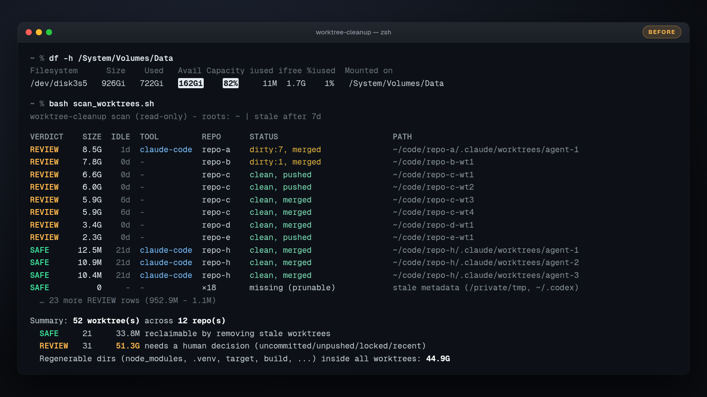
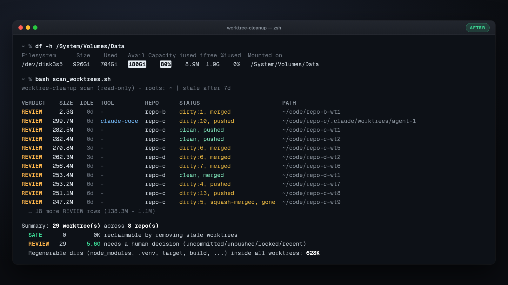

# worktree-cleanup

**AI coding agents love spinning up git worktrees and never cleaning them up.**

This is an [Agent Skill](https://agentskills.io) that lets your coding agent (Claude Code, Cursor, Codex, and other tools that support `SKILL.md`) find every stale worktree on your machine, measure it, and tell you which ones are safe to delete. It removes them only after you say yes.

Tell your agent *"I'm low on disk space"* and it will:

1. **Scan** your repos and the folders where agents keep worktrees (Cursor, Claude Code, Codex, Conductor, Superset, VS Code, Gemini CLI, claude-squad, Vibe Kanban). This step is read-only.
2. **Classify** every worktree:
   - **SAFE**: clean, merged (including squash merges), not locked, and idle for a while.
   - **REVIEW**: has uncommitted changes, unpushed commits, a lock, or recent activity.
3. **Show you a table** with sizes and wait for your answer.
4. **Remove** only what you approved, with `git worktree remove` and then `git worktree prune`. It never runs `rm -rf` on your work.

## Real run

A real run on my Mac mini: 52 agent worktrees taking 51.3 GB went down to 29 worktrees taking 5.6 GB, and free space went from 162 GB to 180 GB. Repo names are anonymized.





## Install

The skill folder must be named `worktree-cleanup` so it matches the skill's `name`.

**Claude Code** (personal skills live in `~/.claude/skills/`):

```bash
git clone https://github.com/gregkop/worktree-cleanup ~/.claude/skills/worktree-cleanup
```

**Cursor** (loads `~/.cursor/skills/` and `~/.agents/skills/`, and also reads `~/.claude/skills/`):

```bash
git clone https://github.com/gregkop/worktree-cleanup ~/.cursor/skills/worktree-cleanup
```

**Codex** (user skills live in `~/.agents/skills/`):

```bash
git clone https://github.com/gregkop/worktree-cleanup ~/.agents/skills/worktree-cleanup
```

**All three with one copy.** Cursor and Codex both read `~/.agents/skills`, and Claude Code follows symlinked skill folders:

```bash
git clone https://github.com/gregkop/worktree-cleanup ~/.agents/skills/worktree-cleanup
mkdir -p ~/.claude/skills && ln -s ~/.agents/skills/worktree-cleanup ~/.claude/skills/worktree-cleanup
```

To install it for one project instead, put it in `.claude/skills/`, `.cursor/skills/`, or `.agents/skills/` inside the repo.

## Use

- Just describe the problem: *"my disk is full"*, *"clean up old worktrees"*, *"what is eating my SSD?"*
- Or invoke it directly: `/worktree-cleanup` in Claude Code or Cursor, `$worktree-cleanup` in Codex.
- Or run the scanner yourself. It needs no agent:

```bash
bash ~/.agents/skills/worktree-cleanup/scripts/scan_worktrees.sh          # scan $HOME
bash .../scan_worktrees.sh ~/code --stale-days 14                         # narrower, stricter
bash .../scan_worktrees.sh --json                                         # for scripts and agents
bash .../scan_worktrees.sh --plan                                         # print (never run) removal commands
```

## Example output

From the bundled sandbox test (`tests/sandbox_test.sh`). On a real machine the sizes are in GB.

```text
worktree-cleanup scan (read-only) - roots: ~ | stale after 7d

VERDICT    SIZE  IDLE  TOOL          REPO    BRANCH             STATUS                      PATH
SAFE       6.0M   30d  cursor        webapp  feat/merged        clean, merged               ~/.cursor/worktrees/webapp/abc1
SAFE        24K   30d  cursor        webapp  feat/squash        clean, squash-merged, gone  ~/.cursor/worktrees/webapp/sq9
SAFE        20K   30d  codex         webapp  (deca245)          clean, merged               ~/.codex/worktrees/1a2b/webapp
SAFE        16K   30d  vscode?       api     feat-x             clean, merged               ~/code/api.worktrees/feat-x
SAFE          0     -  superset      webapp  fix-typo           missing (prunable)          ~/.superset/worktrees/webapp/fix-typo
REVIEW      24K   30d  cursor        webapp  feat/open-pr       clean, pushed               ~/.cursor/worktrees/webapp/pr7
REVIEW      24K   30d  claude-code   webapp  worktree-refactor  dirty:2, merged             ~/code/webapp/.claude/worktrees/refactor
REVIEW      24K   30d  conductor     webapp  feat/unpushed      clean, unpushed:2           ~/conductor/workspaces/webapp/oslo
REVIEW      20K   30d  claude-squad  webapp  squad/task         clean, merged, locked       ~/.claude-squad/worktrees/task_17a
REVIEW      20K    0d  codex         webapp  (deca245)          clean, merged               ~/.codex/worktrees/9f8e/webapp
REVIEW      16K    0d  cursor        doomed  -                  orphaned                    ~/.cursor/worktrees/doomed/zz1

Summary: 11 worktree(s) across 2 repo(s) (incl. 1 orphaned dir(s))
  SAFE      5      6.1M reclaimable by removing stale worktrees
  REVIEW    6      128K needs a human decision (uncommitted/unpushed/locked/recent)
  Regenerable dirs (node_modules, .venv, target, build, ...) inside all worktrees: 6.0M

Agent worktree locations found:
  cursor        ~/.cursor/worktrees                             4 worktree(s)  6.1M
  codex         ~/.codex/worktrees                              2 worktree(s)  40K
  conductor     ~/conductor/workspaces                          1 worktree(s)  24K
  superset      ~/.superset/worktrees                           1 worktree(s)  0K
  claude-squad  ~/.claude-squad/worktrees                       1 worktree(s)  20K

Nothing was modified. Use --plan to print removal commands for SAFE rows, --json for machine output.
```

## How verdicts are decided

| Verdict | Condition |
|---|---|
| **SAFE** | The directory is already gone (prunable metadata), **or** all of these hold: no modified or untracked files; HEAD is merged into the default branch (by ancestry, rebase, or squash patch-id match), or every commit is already on a remote and the upstream branch was deleted or HEAD is detached; not locked; idle at least `--stale-days` (default 7). |
| **REVIEW** | Anything else: dirty, unpushed or unmerged commits, pushed but not merged (open PR?), locked, recently active, it's your current directory, has submodules, orphaned (its repo was deleted), or couldn't be inspected. |

## Safety

- **The scanner is read-only.** It never deletes, moves, fetches, or pushes. It sets `GIT_OPTIONAL_LOCKS=0` so even `git status` won't rewrite an index.
- **Nothing is removed without your explicit OK** on a specific list.
- **Removal uses `git worktree remove` without `--force`.** Git itself refuses to delete a worktree with modified or untracked files, or one that is locked.
- **Branches are kept.** Removing a worktree does not delete its branch.
- **Ignored files go with the worktree.** That includes `.env` copies, `node_modules`, and build output. The agent warns you when this matters.
- **Caches are report-only.** Other disk hogs (npm/pnpm/uv caches, Docker, Xcode DerivedData) are listed with sizes and never deleted.

## Requirements

macOS or Linux, `git` (2.31+ recommended), and bash 3.2+ (the stock macOS bash works). No other dependencies and no network access.

## Development

```bash
tests/sandbox_test.sh            # builds a throwaway sandbox of repos and worktrees and checks every verdict
shellcheck scripts/*.sh tests/*.sh
```

Agent worktree paths and their sources are in [`references/agent-locations.md`](references/agent-locations.md). PRs for more tools are welcome. Please include a link to docs or source.

## License

MIT © 2026 Greg Kopyltsov
